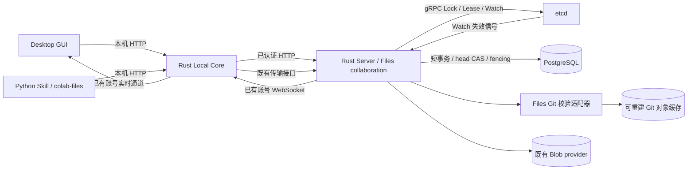

# Files 中心锁与协作编辑方案

日期：2026-10-15。状态：供评审的设计，尚未实现；本文不表示已上线能力。

## 1. 决策与范围

采用 etcd 提供中心互斥锁、租约和 Watch，文件字节继续使用现有 Files
shadow Git / Git pack / Blob 存储链路。不给用户引入 SVN 仓库或第二套 ignore。

第一版只覆盖 Files。复用现有单文件/目录选择、范围预览、`.gitignore`、
附加 exclusions、资产注册、Catalog 放置、稳定引用和 Give to Agent。
Session、Canvas、Skill 和 Quick Share 不接入这套编辑锁。

目标是：同一文件同一时刻只有一个有效编辑执行实例；不同文件允许并行编辑；
服务端拒绝无锁、失效锁或超出 checkout 范围的提交。提示词要求 Agent 先
checkout 再编辑，不尝试拦截普通本地文件系统写入。

这是现有 Files 的能力扩展：当前接收端是只读缓存，不能直接改成所有人都写的
公共目录。需要新增受管理的编辑工作副本和发布入口。

## 2. 用户如何指定管理范围

### 2.1 新建

1. 用户仍从 Add → Files / Home → Share my Files 进入现有弹层。
2. 仍选择一个本地文件或目录；Core 使用既有 inspection 展示有效文件和字节量。
3. 弹层增加模式选择，默认保留「同步共享」，可选「锁定协作」。
4. 锁定协作说明：成员可 checkout 文件修改；同文件互斥、不同文件可并行。
   启用范围就是这次 Files item 的有效范围，不需要重新选择项目或配置 ignore。
5. 注册沿用已有逻辑，第一份内容发布完成后才能启用协作；准备中立即显示进度，
   不用长请求等待扫描、上传。失败保留注册状态和真实重试入口。

目录下所有有效文件默认受管理；单文件只管理该文件。目录中的文件先采用
文件级锁；选择目录执行 checkout 表示选取当前目录下的文件集合，不宣称获得
阻止未来新增文件的「递归目录锁」。

### 2.2 已有 Files

贡献者在详情 More → Collaboration 中启用锁定协作，复用现有资产，不重新上传
或创建另一个 Channel item。Server 冻结当前已发布 root，准备文件索引后切换模式。
已有未同步改动须先发布或明确留在本地，不能切模式时悄悄覆盖。

这项模式、有效范围和锁属于底层 asset，在所有 Channel 引用上共同生效；
不是一个 Channel 的私有设置。启用前展示影响的共享引用数量。

### 2.3 原始目录和受管理目录的关系

同步共享模式保留现在「贡献者原始目录 → 自动发布 → 接收端只读缓存」的行为。

锁定协作模式以 Server 已接受的内容为共享真源：

- Core 为每个 checkout 建立独立编辑副本。它与既有只读 materialization 分开，
  后台刷新不能清空或覆盖编辑副本；不同 Agent 不共用可写目录。
- 原始选择目录不被移动、不加 `.svn`、不修改 `.git`，可继续使用原 Git 项目。
- 启用后，原始目录 watcher 不再绕过锁直接发布。原始目录变化显示为
  「本地变更待导入」；用户/Agent 通过 checkout + 导入差异 + 提交纳入共享版本。
- 拉取协作结果回原始目录是显式操作，先检查本地未提交修改；第一版不自动写回
  贡献者的 Git 工作目录，不自动合并分支或回滚本地文件。

这项写入通道切换必须在启用说明中直说。否则贡献者的自动发布会覆盖其他人的
协作提交，中心锁实际上没有覆盖所有发布者。

### 2.4 GUI

保留详情左上名称/面包屑、右上 primary Give to Agent。次要动作仍在 More。
文件树/单文件预览显示「可编辑」「某人/Agent 正在编辑」「本次 checkout」等
轻量状态。悬停给出持有者、开始时间、连接状态；不把租约/token 放进产品文案。

人类可通过同一 checkout 流程打开本地编辑副本，在编辑器中修改后提交或释放。
有本地未提交修改时，释放动作须明确显示「保留本地修改但停止占锁」，不得删除。
抢锁失败展示占用者；不静默等待、不后台强制解锁。

## 3. Agent 使用方式

以下为拟新增接口，不是当前可执行命令。发现仍用 colab-explorer，读取仍复用
现有 Files use；增加独立 colab-files 入口承载编辑生命周期：

```text
colab-files status   --ref <稳定 Files 引用> [--path src/main.rs]
colab-files checkout --ref <稳定 Files 引用> --path src/main.rs --path docs/spec.md
colab-files diff     --checkout <checkout-id>
colab-files submit   --checkout <checkout-id>
colab-files renew    --checkout <checkout-id> --hold-for 30m
colab-files release  --checkout <checkout-id>
```

checkout 可先返回 preparing 和 checkout-id，CLI 有界等待/查询直到 ready；
只有 ready 才返回可写 workingPath、允许路径、基准版本和锁状态。
内部 token/etcd 凭据不出现在提示词中，token 保存在 Core 的账号隔离状态中。
submit 成功返回已提交 root 和是否释放锁；默认提交后释放，显式 keep-lock 才继续。
release 保留本地修改，后续提交必须重新取锁并核对当前基准。

Give to Agent 在锁定协作模式中说明：

> 先查看文件；修改前对目标路径执行 checkout。仅在返回的 workingPath 中编辑。
> 新增、删除、重命名涉及的路径也须包含在 checkout 范围。修改后检查 diff 并
> submit。遇到占锁或锁失效，停止提交，保留修改并报告；不要绕过工具直接发布。

同一账号的不同 Agent 执行实例使用不同 checkout-id、租约和工作副本，不能
因 user-id 相同就复用持有资格。无法识别 provider task-id 的外部 Agent，由
checkout 操作创建新的执行实例标识，不用一个设备级锁身份代表所有 Agent。

## 4. 服务与模块关系



不新增 GUI/Skill 到 etcd 的直连。etcd 只对 Server 内网开放，使用独立服务身份、
TLS 和部署命名空间；公开版与企业版的 endpoint/凭据仍由各自 ignored 配置提供。
单节点可用于试验；需要容忍一节点故障的正式部署使用三成员集群。

| 所属单元 | 新增职责 | 复用部分 |
|---|---|---|
| GUI | 模式选择、锁状态、checkout/提交交互 | Files 弹层、预览树、标准 Dialog、More、Give to Agent |
| Skill | colab-files 薄命令入口和编辑提示词 | Local API 认证、稳定引用解析、Explorer 发现 |
| Core | checkout 工作副本、续租、差异、持久任务、断线恢复 | Files 对象缓存、Git pack、SQLite、现有账号实时通道 |
| Server | 鉴权、锁协调、checkout 生命周期、提交准入、事件过滤 | asset/reference、成员权限、revision CAS、Blob、账号 WS |
| etcd | 排他所有权、租约、Watch | 原生 v3 Lock/Lease/Watch |
| PostgreSQL | 资产模式、编辑授权、执行记录、fence、内容 head | 现有资产和共享引用；不另建第二套活锁真源 |
| Files Git 适配器 | 校验候选内容真实改动路径和基准 | 成熟 Git plumbing；不执行源项目 hook/filter |

Core 新模块按能力拆为 files_collaboration、files_checkouts、files_edit_worktree；
Server 拆为 files_collaboration API/use-case、lock_backend、files_commit_validator。
不把这些逻辑继续堆进 files.rs、main.tsx 或 Electron。

## 5. 实体与归属

| 实体 | 核心字段 | 说明 |
|---|---|---|
| shared_assets 扩展 | collaboration_mode、policy_epoch | 既有 asset-id 不变；改名/移动 Catalog 不改变锁身份 |
| FilesEditGrant | asset-id、user-id、enabled | 第一版贡献者显式授予成员编辑权；Channel 可见性仍是必要条件 |
| FilesCheckout | id、asset-id、user/device/execution、授权 reference、状态、base-root、hold-until | Server 持久操作记录；etcd 活锁才表示当前持有 |
| CheckoutPath | checkout-id、规范相对路径、base-blob-oid/不存在、operation、path-fence | 约束改、增、删、重命名范围 |
| FilesPathFence | asset-id、规范相对路径、generation | 路径级单调发布屏障；给 b.rs 授锁不会让 a.rs 持有者失效 |
| FilesScopePolicy | asset-id、epoch、规则快照摘要、已批准规则快照 | 从既有 ignore 配置派生，只供提交验证；不是另一套用户配置 |
| etcd lock | deployment/asset/path、lease、opaque lock-key | 活锁真源；不存文件字节、凭据或完整任务提示词 |
| 本地 checkout | account-id、checkout-id、working-path、base-root、本地状态 | Core SQLite；与只读接收缓存严格区分 |
| FilesCommit | checkout-id、幂等 nonce、候选 root、当前 root、结果 | 重试/响应丢失可查询，不凭本地成功猜测提交成功 |

锁命名使用 asset-id + 规范化相对文件路径，不使用 Channel、可改名的 item 名称
或各终端绝对路径。锁名称中的路径可编码/散列，Server 保留授权后的展示映射。
必须拒绝绝对路径、`..`、越界链接、平台路径别名及大小写碰撞，避免同一文件两把锁。

编辑资格采用「指定引用仍可访问 + asset 编辑授权」。从 A Channel 进入的 checkout
不能在 A 的权限被撤销后悄悄改用 B Channel 的权限继续提交；用户可经 B 新建操作。
贡献者的管理/强制释放权限属于 asset，而不是任意引用所在 Channel 的管理员。

## 6. 锁的粒度和生命周期

- 普通 checkout 锁定明确文件路径；新增文件预留目标路径；删除持有原路径。
- 文件重命名同时持有旧、新路径；新路径必须仍不存在，不能覆盖另一个人的文件。
- 第一版不做递归目录独占锁。目录批量操作展开到有限路径集合；目录删除在提交时
  验证无未覆盖/后来新增子项，否则返回目录已变化，不能顺手删除别人的新文件。
- 批量 checkout 全有或全无。原生锁按统一顺序获取，有限等待；任意失败则释放
  本次已取得的部分，操作不进入 ready。首版上限 128 路径，避免无限排队/大事务。
- 每个 checkout 独立 etcd 租约；初始建议 TTL 120 秒、Core 每 30 秒续租，须经
  `.trial` 的休眠/网络测试校准。默认编辑窗口 30 分钟，由 hold-until 限制 Core
  续租；长任务在到期前调用 renew 显式延长，GUI 提前提示。任务明确结束、释放或
  到达窗口上限就停止续租，不因 Core 一直运行而永久占锁。提示词包含延长入口。
- 断线时立即显示不确定，保留编辑内容；确认租约失效后标记 lost，禁止发布。
- 提交成功默认释放。贡献者可强制释放，需理由并使旧持有者立即失去后续提交资格。

## 7. 请求链路

拟新增的 Local API 与 Server API 使用同一领域边界（以下不是已存在接口）：

| 接口 | 作用 |
|---|---|
| GET/PATCH /v1/files/{reference}/collaboration | 读取/变更模式和编辑授权；变更仅贡献者 |
| GET /v1/files/{reference}/locks | 已授权资产锁快照，带版本/freshness |
| POST /v1/files/{reference}/checkouts | 路径集合和幂等请求，返回 ready 或 preparing 操作 |
| GET /v1/files/checkouts/{id} | 操作状态；只有 Core 本机响应包含本地工作目录 |
| POST /v1/files/checkouts/{id}/renew | 延长编辑窗口，Core 在窗口内续租 |
| POST /v1/files/checkouts/{id}/submit | 既有字节传输和新增校验/提交流程；可异步查询 receipt |
| POST /v1/files/checkouts/{id}/release | 释放自己的锁，保留本地修改 |
| POST /v1/files/{reference}/locks/revoke | 贡献者强制撤销，带操作理由 |

Server 请求不接收可作为授权依据的本地绝对路径或客户端自报 owner。
Core 在账号切换后仍以 checkout 原所属账号续租/提交，不使用 GUI 当前账号代发。

### 7.1 启用

GUI/Skill → Core → Server。Server 验证贡献者身份和当前 root，设置 preparing，
阻止旧 watcher 新发布并等待已准入的旧发布结束。初始化当前 root 的文件索引，
原子切换 mode/policy-epoch。失败保留原模式，不出现两条有效写入通道。
旧 Core/旧发布 API 在锁定模式收到明确的 collaboration-required 错误，不能绕过。

### 7.2 checkout

1. Agent/GUI 提交稳定引用、目标路径、执行实例/请求 nonce 到 Core。
2. Core 调 Server。Server 解析 reference → asset，校验成员、编辑授权和有效范围。
3. Server 使用 etcd 原生锁获取全部目标路径。相同用户的其他 checkout 不算重入。
4. 锁全部取得后，在资产短事务中推进各目标路径的 fence，记录 checkout 和当前路径
   基准；提交记录成功才返回持有资格。中途失败释放租约，残留会自行过期。
5. Core 复用对象缓存获取基准，建立隔离工作副本；准备完毕返回 ready 和 workingPath。
   物化期间续租，失败释放锁、保留真实失败状态，不返回可编辑成功。

### 7.3 状态推送与本地查询

etcd Watch → Server 锁事件适配器 → 既有账号实时通道 → Core → GUI/Skill 本地缓存。
Server 按当前 asset 引用权限筛选订阅者；不把其他 Channel 成员、etcd key 或 token
广播给用户。事件只携带 asset-id、状态版本和失效提示。

本地 status 可快速返回缓存及 freshness，不必每次请求中央服务。checkout/submit
始终向中央校验。首次订阅先取快照并从相应 revision 接续 Watch；断线、Watch
compaction、Server 切换或权限变化时重新取快照。GUI 复用同一账号 WebSocket，
不新增功能专属 socket。暂未接收更新时显示 unknown，不能用缺少消息推断 unlocked。

### 7.4 编辑、提交与不同文件并发

1. Agent 修改隔离副本。Core diff 只允许 checkout 路径，沿用既有 ignore 范围；
   `.gitignore` 或共享 scope 本身的变更第一版走贡献者独立管理操作，不混入普通编辑。
2. submit 在 Core 冻结候选字节，生成 Git pack 和路径 manifest，通过现有传输层
   上传到待提交区。上传成功不等于共享 head 已更新，上传阶段不长占数据库事务。
3. Server 的 Files Git 适配器在隔离缓存中验证 pack、候选 tree、实际差异路径、
   类型和 digest。不能只相信客户端声称「只改了 a.txt」；现有 opaque pack 接口
   不具备这项保证，必须扩展这一校验才能开放多写入者。
4. 最终准入使用短事务串行化 asset head：重新检查当前权限、policy-epoch、
   checkout 状态、fence 和 etcd 锁仍归本 checkout；然后 CAS 当前 root，记录
   幂等提交 receipt 与实时 outbox，同事务提交。
5. 若其他 Agent 已提交不同文件，旧的全树 root 不能直接覆盖当前 root。返回
   head-changed，Core 读取新 root；确认本次目标文件仍等于记录的 base-blob-oid，
   把本次已锁定路径的替换/新增/删除应用到新树，重新打包并有界重试。
   这是不同路径的树合成，不进行文本冲突自动合并。
6. 目标文件的基准也变化则拒绝提交并保留本地修改。提交成功后更新只读缓存、
   通知其他终端，并按策略释放锁。重复 nonce 返回原 receipt，不重复生成版本。

例如 A 锁 a.rs、B 锁 b.rs，各自从 R0 开始：A 发布 R1 后，B 将自己的 b.rs
变化放到 R1 上得到 R2；R2 同时包含两人的结果，不能用 B 的旧树把 a.rs 恢复成 R0。

## 8. etcd 与 PostgreSQL 的一致性边界

不能声称「查一次 etcd，然后写数据库」就是跨服务原子提交。

etcd 是活锁所有权真源；PostgreSQL 中各路径的 fence-generation 是发布防旧写屏障，
checkout 表是操作/授权记录，不独立授予锁。每次授予 ready、强制释放、改变
协作模式及最终发布，都在同一个 asset 行锁的短临界区内协调：

- 新持有者先取得 etcd 锁，再取得 asset 行锁、推进所持路径的 generation、登记资格；
  登记完成前不向客户端返回可提交资格。
- 旧提交在同一 asset 行锁下核对其 checkout、每个目标路径的 generation 和 etcd 锁 key，
  核对成功的时刻是提交准入点。之后只完成短 head/receipt 事务，不执行上传或打包。
- 已经准入的短事务允许完成；即使这几毫秒内租约到期，新持有者仍须等待 asset
  行锁并在其后登记资格。不能出现「新持有者已经登记且提交后，旧持有者再覆盖」。
- 强制释放先在同一行锁下撤销资格，再释放 etcd 租约。旧请求随后必被拒绝。
- etcd 查询失败不授予新资格、不准入新提交；现有内容读取可继续。

过期但还没登记新持有者的 checkout 仍须通过活锁校验，不能仅因数据库记录
active 就继续提交。Server 崩溃留下的未登记锁由租约清除；etcd/数据库恢复后
必须重新验证，不能把历史 active 行自动恢复为有效锁。

这些时序是实施前必须实测的协议，不因采用成熟 etcd 就视为已验证。

## 9. 存储、ignore 与迁移

不新增文件版本体系。原 Git 对象和增量 pack、Blob provider、revision/root CAS
继续工作；Server 校验缓存可删除重建，不能变成第二份权威文件源。冷缓存可能需
重放历史 pack，须测延迟、限并发并设容量预算，不能让首次校验无限占内存。

`.gitignore` 仍由 Core 现有 Git 语义计算，附加 exclusions 仍读 shadow info/exclude。
协作提交复用 asset 当前已批准的有效范围，服务端对路径和候选树再次校验。
第一版不允许普通成员通过改 ignore 间接删除共享文件。

为使新文件也能在服务端按相同规则验证，启用模式时由贡献者 Core 从既有
`.gitignore`（含嵌套规则）和 shadow info/exclude 生成不可变规则快照，绑定
scope epoch。Server 使用同样的 Git ignore 语义验证候选新增路径；不提供另一个
规则编辑器。后续修改仍从原有 scope 管理入口派生新快照，待在途操作完成后切换
epoch，旧 checkout 必须刷新授权范围。ignore 文件本身未被发布也不能漏掉规则快照。

现有引用、名称、Catalog、读取工具保持身份兼容；只读 use 不会突然返回可写
公共缓存。只有显式启用的 Files 才使用新协议。撤回一个引用不释放其他引用的
资产锁；终止该引用发起的 checkout。最后引用撤回时撤销全部编辑资格，再按
现有保留/GC 规则处理内容，本地编辑副本保留。

关闭锁定协作仅贡献者操作：停止新 checkout，处理在途提交，保留最终 root，
明确选择后续发布来源。不能直接恢复 watcher 并把过时原始目录全量覆盖回来。
代码回滚保留协作资产只读；旧 Server 不理解强制锁协议时禁止降级继续写这些资产。

## 10. 实施分段与验收

1. `.trial` 验证 etcd 取锁/续租/Watch、双账号/同账号双实例、批量失败回收、
   断网/休眠/服务重启/强制释放；验证上一节跨服务提交时序。
2. Server 协作协议、fence、权限和 pack 实际差异校验；Core 隔离编辑副本和
   checkout CLI。先跑工具链闭环，再接 GUI，不先放不可用按钮。
3. Files 新建/已有模式入口、锁状态、Give to Agent 提示词和恢复交互。
4. 用同资产跨 Channel、A/B 不同文件并发和撤权在途提交完成验收后，按 Server →
   Core/Skill → GUI 独立发布。etcd 的部署、健康和备份是额外服务验收项。

必测：同文件唯一持有；不同文件并行且结果都保留；同账号不同实例不能冒用；
无锁/过期/旧 token/越界提交拒绝；断线保留修改；新建同名冲突；重命名与删除；
ignore 一致；旧 watcher 绕过拒绝；权限撤销；幂等重试；跨 Channel 同一把锁；
Watch 漏事件/compaction 重建；冷缓存 Git 校验的耗时和存储上界。

Tracing 注册到各自所属单元：checkout、submit、release、forced-release 为用户
操作；renew/watch/reconcile 为后台操作，分开统计。记录 checkout-id、锁等待、
状态、fence、base/current root、错误码，不记录 token、etcd 凭据或文件正文。
测试的断言同时检查真实 head/文件摘要和拒绝结果，不以广播或 HTTP 200 代替提交成功。

## 11. 依据与设计审阅重点

- 现有边界：`shared-assets-design.md`、`technical-design.md` Files 章节、
  `agent-interface.md`，以及 Core files.rs 的只读接收缓存/增量发布实现。
- 存储实验：`.trial/files-vcs/README.md`；本次不以更换版本系统节省容量为前提。
- etcd 原生能力：[Lock API](https://etcd.io/docs/v3.6/dev-guide/api_concurrency_reference_v3/)、
  [Lease/Watch/事务](https://etcd.io/docs/v3.6/learning/api/)。目录语义、业务权限、
  文件提交校验、fencing 与本地工作副本不是 etcd 自动提供的能力。

建议按本方案的两个产品决定评审：锁定协作是显式资产模式；第一版使用隔离编辑
副本，原始目录变化显式导入。它们使中心锁覆盖真实发布入口，同时保护已有 Git 项目。
